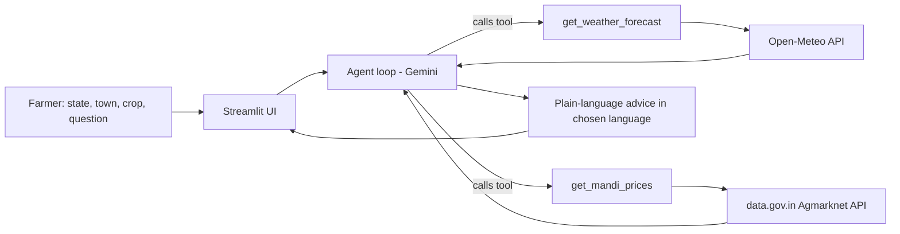

# 🌾 Multilingual Agritech & Resource Advisory Assistant

FORGE '26 Gen AI Hackathon, Theme 2: Climate, Resource Infrastructure & Global Supply Resilience.

## Problem
Farmers face unpredictable weather and volatile market prices, and most advice tools are not in their language. Decisions such as "irrigate or wait?" and "sell now or hold?" depend on live weather and live mandi prices.

## Solution
An AI agent that decides which tools to call, fetches live data, and replies with simple, crop-specific advice in English, Hindi or Odia.

## Live data sources (no dummy or hardcoded data)
- Weather: Open-Meteo API (live forecast)
- Market prices: data.gov.in Agmarknet daily mandi prices (live)
- AI reasoning: Google Gemini with function calling

## Architecture


## How the agent works
1. The farmer picks state, town, crop and language, then asks a question.
2. Gemini decides which tools are needed and with what arguments.
3. The tools call live APIs and return real data.
4. Gemini combines the data into short advice. If a service is down, it says so and never invents numbers.
5. The UI shows each tool call, so the reasoning is visible.

## Setup
```
git clone https://github.com/ManMohanit/Hackathon.git
cd Hackathon
python -m venv venv
venv\Scripts\activate
pip install -r requirements.txt
```
Create a `.env` file:
```
GEMINI_API_KEY=your_key
DATA_GOV_API_KEY=your_key
```
Run:
```
streamlit run app.py
```

## Project files
- `app.py`: Streamlit chat interface
- `agent.py`: agent loop and Gemini function calling
- `tools.py`: live weather and mandi price tools
- `locations.py`: dropdown lists for states, towns and crops (UI options only)

## Limitations and roadmap
- Voice input and more Indian languages
- Soil data and satellite-based yield forecasts
- SMS/WhatsApp delivery for farmers without smartphones
- If prices for a state are missing, the app shows prices from other states and labels them as not local.

## Team
(Add team member names)